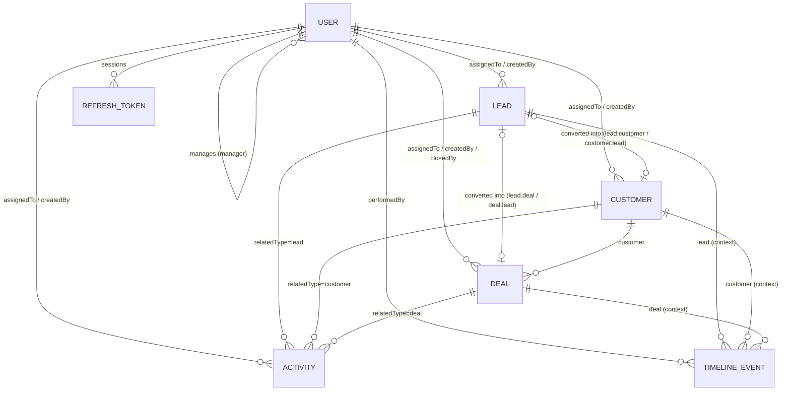

# MongoDB Database Design

Database: `crm_sales` (MongoDB ≥ 6, **replica set** — required for multi-document transactions).

## Entity-relationship overview



The conversion lineage required by the brief:

```
Lead ──(customer.lead)──▶ Customer ──(deal.customer)──▶ Deal
  ▲                                                       │
  └──────────────────────(deal.lead)──────────────────────┘
lead.customer and lead.deal are back-references set in the same transaction.
```

## Modelling decisions

| Decision | Why |
|---|---|
| **References** between users, leads, customers, deals, activities | Each entity is created, filtered, paginated, assigned and secured independently; activities and timeline entries grow without bound (unbounded arrays inside a document are an anti-pattern and would hit the 16 MB limit). |
| **Embedded** `customer.address` | No identity or lifecycle of its own; always read together with the customer. |
| **Back-references on the lead** (`lead.customer`, `lead.deal`) | O(1) navigation from a lead to what it became, without a reverse query. Written in the conversion transaction, so they cannot drift. |
| **Virtual populate** `customer.deals` | One-to-many without storing an array of deal IDs on the customer (no write amplification, no unbounded array). |
| **Polymorphic activity association** (`relatedType` + `relatedId`, dynamic `ref`) | One collection and one set of APIs for activities on leads, customers, deals and users. |
| **Denormalised context** on timeline events (`lead`, `customer`, `deal`) | A lead's full history — including events of the customer and deal it became — is a single indexed query. Events are immutable, so denormalisation cannot go stale. |
| **Stored derived fields** `deal.status`, `deal.expectedRevenue` | Computed in a `pre('validate')` hook (never accepted from clients) and stored so filters and `$group` aggregations stay index-friendly. |
| **Activity `overdue` not stored** | Overdue is a function of time. Storing it would need a cron job and would be wrong between runs; the API derives it at read time and translates `status=overdue` into a query. |
| **Refresh tokens in their own collection** | Supports multiple sessions per user, rotation chains (`family`), revocation and TTL clean-up; only SHA-256 hashes are stored. |
| **Singleton `settings` document** | Admin-managed CRM configuration (stage probabilities, currency, close-date horizon), cached in memory for 60 s. |

## Collections

### `users`

| Field | Type | Notes |
|---|---|---|
| `_id` | ObjectId | |
| `name` | String | required, ≤ 100 |
| `email` | String | required, lowercase, **unique** |
| `phone` | String | normalised E.164-like |
| `password` | String | bcrypt hash, `select: false`, never serialised |
| `role` | String | `admin` \| `sales_manager` \| `sales_executive` |
| `manager` | ObjectId → users | only for `sales_executive` |
| `isActive` | Boolean | inactive users cannot log in or be assigned |
| `lastLoginAt`, `passwordChangedAt` | Date | |
| `tokenVersion` | Number | `select: false`; bump = revoke all access tokens |
| `failedLoginAttempts`, `lockUntil` | Number, Date | `select: false`; lockout policy |
| `createdAt`, `updatedAt` | Date | timestamps |

Indexes: `{ email: 1 }` unique · `{ role: 1, isActive: 1 }` · `{ manager: 1, role: 1 }` · `{ createdAt: -1 }`

### `leads`

| Field | Type | Notes |
|---|---|---|
| `name` | String | required |
| `email` | String | lowercase, unique when present |
| `phone`, `company`, `description` | String | |
| `source` | String | `website` \| `referral` \| `social_media` \| `email` \| `phone` \| `other` |
| `status` | String | `new` \| `contacted` \| `qualified` \| `unqualified` \| `converted` \| `lost` |
| `priority` | String | `low` \| `medium` \| `high` |
| `lostReason` | String | required by the API when status becomes `lost` |
| `assignedTo` | ObjectId → users | active sales executive, nullable |
| `createdBy` | ObjectId → users | |
| `convertedAt`, `convertedBy` | Date, ObjectId | set by conversion |
| `customer`, `deal` | ObjectId → customers / deals | back-references set by conversion |

Indexes: `{ email: 1 }` unique, partial (`email` is a string) · `{ assignedTo: 1, status: 1, createdAt: -1 }` · `{ status: 1, createdAt: -1 }` · `{ source: 1, createdAt: -1 }` · `{ priority: 1 }` · `{ createdBy: 1 }` · `{ createdAt: -1 }`

### `customers`

| Field | Type | Notes |
|---|---|---|
| `name` | String | required |
| `email` | String | lowercase, unique when present |
| `phone`, `company`, `description` | String | |
| `address` | Embedded `{ street, city, state, postalCode, country }` | |
| `status` | String | `active` \| `inactive` \| `churned` |
| `lead` | ObjectId → leads | original lead, **unique when present** |
| `assignedTo`, `createdBy` | ObjectId → users | |
| `deals` (virtual) | → deals | populated on the detail endpoint |

Indexes: `{ email: 1 }` unique, partial · `{ lead: 1 }` unique, partial (`lead` is an ObjectId) — DB-level guarantee that a lead converts at most once · `{ assignedTo: 1, status: 1, createdAt: -1 }` · `{ status: 1 }` · `{ createdAt: -1 }`

### `deals`

| Field | Type | Notes |
|---|---|---|
| `name` | String | required |
| `lead` | ObjectId → leads | nullable (deals on directly created customers) |
| `customer` | ObjectId → customers | required |
| `assignedTo`, `createdBy`, `closedBy` | ObjectId → users | |
| `value` | Number | > 0 |
| `currency` | String | ISO 4217, default from settings |
| `probability` | Number | 0–100; defaults to the stage probability; forced to 100 (won) / 0 (lost) |
| `expectedRevenue` | Number | **server-computed**: `value × probability / 100` |
| `expectedCloseDate` | Date | today … today + `maxDealCloseDays` |
| `stage` | String | `qualification` \| `discovery` \| `proposal` \| `negotiation` \| `won` \| `lost` |
| `status` | String | derived: `open` \| `won` \| `lost` |
| `closedAt` | Date | set on won/lost, cleared on reopen |
| `lostReason`, `description` | String | |

Indexes: `{ assignedTo: 1, stage: 1, createdAt: -1 }` · `{ stage: 1, value: 1 }` · `{ status: 1, expectedCloseDate: 1 }` · `{ status: 1, closedAt: -1 }` · `{ customer: 1, createdAt: -1 }` · `{ lead: 1 }` · `{ createdAt: -1 }`

### `activities`

| Field | Type | Notes |
|---|---|---|
| `type` | String | `call` \| `email` \| `meeting` \| `demo` \| `follow_up` \| `reminder` \| `note` |
| `title`, `description`, `outcome` | String | |
| `status` | String | persisted: `pending` \| `completed` — `overdue` is derived |
| `dueDate` | Date | required except for notes |
| `completedAt`, `completedBy` | Date, ObjectId | |
| `assignedTo`, `createdBy` | ObjectId → users | |
| `relatedType` | String | `lead` \| `customer` \| `deal` \| `user` |
| `relatedId` | ObjectId | dynamic `ref` based on `relatedType` |

Indexes: `{ assignedTo: 1, status: 1, dueDate: 1 }` · `{ status: 1, dueDate: 1 }` · `{ relatedType: 1, relatedId: 1, createdAt: -1 }` · `{ createdBy: 1, createdAt: -1 }` · `{ createdAt: -1 }`

### `timelineevents` (append-only audit log)

| Field | Type | Notes |
|---|---|---|
| `action` | String | e.g. `lead_converted`, `deal_stage_changed` (31 actions) |
| `entityType`, `entityId` | String, ObjectId | subject of the event |
| `performedBy` | ObjectId → users | |
| `previousValue`, `newValue` | Mixed | changed fields / values |
| `message` | String | reason, note |
| `lead`, `customer`, `deal` | ObjectId | context references |
| `createdAt` | Date | timestamp (no `updatedAt` — events are immutable) |

Indexes: `{ entityType: 1, entityId: 1, createdAt: -1 }` · `{ lead: 1, createdAt: -1 }` partial · `{ customer: 1, createdAt: -1 }` partial · `{ deal: 1, createdAt: -1 }` partial · `{ performedBy: 1, createdAt: -1 }` · `{ action: 1, createdAt: -1 }`

### `refreshtokens`

| Field | Type | Notes |
|---|---|---|
| `user` | ObjectId → users | |
| `tokenHash` | String | SHA-256 of the opaque token, unique |
| `family` | String | UUID shared by all rotations of one login |
| `expiresAt` | Date | **TTL index** — MongoDB deletes expired tokens |
| `revokedAt`, `replacedByHash` | Date, String | rotation chain |
| `createdByIp`, `userAgent` | String | session metadata |

### `settings`

Singleton (`key: 'crm'`): `defaultCurrency`, `stageProbabilities.{qualification,discovery,proposal,negotiation}`, `maxDealCloseDays`, `updatedBy`.

## Transactions

Every write that changes state **and** records an audit event runs in a transaction (`utils/transaction.js`, using Mongoose `connection.transaction()` which retries transient errors and resets document state between attempts). The most important one is lead conversion:

```
BEGIN
  leads.findOneAndUpdate({ _id, status: 'qualified' }, { status: 'converted', ... })  -- race guard
  customers.insert({ ..., lead: leadId })                                             -- unique(lead)
  deals.insert({ ..., lead: leadId, customer: customerId })                           -- optional
  leads.update({ customer, deal })                                                    -- back-refs
  timelineevents.insertMany([status_changed, customer_created, deal_created, lead_converted])
COMMIT   (any error → ABORT: nothing is persisted)
```

State-machine operations (lead status, deal stage, assignment) read the document **inside** the transaction, so two concurrent updates produce a write conflict and a retry instead of a lost update.

## Aggregations

| Endpoint | Pipeline |
|---|---|
| `/dashboard/summary` | 3 parallel `$match → $group` (leads by status, deals by status with `$sum` of value/expectedRevenue, pending activities split by `$cond` overdue) + `countDocuments` for customers |
| `/dashboard/pipeline` | `$match (scope) → $group by stage` (count, `$sum` value, `$sum` expectedRevenue, `$avg` probability), stages zero-filled in funnel order |
| `/dashboard/team-performance` | 3 parallel `$group by assignedTo` with conditional sums (`$cond`) over leads, deals and activities, merged per team member |
| `/dashboard/revenue-trend` | `$match won & closedAt ≥ start → $group by { $year, $month }`, zero-filled |
